# 第3段階 UI検証記録

## 前提と依存関係

調査開始時mainは `50ea57a4c`。#9はmain、#10は`feat/v3-anniversaries`、#11は`feat/v3-talent-details`へマージされていました。mainには詳細・グッズが含まれないため、#12でレビュー済み第2段階コードを統合し、UI改善PRはそのブランチをbaseにしています。マージ順は #12 → UI改善PR。本番設定変更やPRのマージは行っていません。

本番の読み取り確認では `/talents/` と `/anniversaries/` は200、`/talents/tal-000001/` と `/goods/` は404でした。ローカルビルドでは全4名の `/talents/tal-000001/`〜`/talents/tal-000004/`、一覧、記念日、グッズを生成し、リンク・sitemapを検証しています。本PRだけでは本番URLは公開されません。

## UI・データの扱い

- 一覧は画像・名前・所属中心。カード全体が1つのリンクで、内部ID・状態コード・所属期間・出典一覧を主要UIから除外。画像未取得時は名前の頭文字、画像未確認のプロフィールでは明示的な代替表示。
- 名前・確認済み別名をNFKC、ひらがな／カタカナ、大小文字を正規化して検索。事務所、所属区分、関連グループをANDで絞り込む。各候補件数はその項目以外の条件を適用した場合の人数。解除で全件表示へ戻る。
- 複数の現在所属・旧所属を扱う。同一事務所に再所属した場合は現在所属を優先。所属未確認を無所属や引退と解釈しない。確認済みの無所属は未確認と分けて表示・絞り込み。グループ台帳に在籍期間・現在状態がないため「確認済みの関連」と表示し、現在の所属グループと断定しない。
- プロフィールはパンくず・戻るリンク・強調した名前と画像、公式リンク、記念日、関連動画、登録がある場合のグッズ、補助的な出典の順。関連動画のアカウントID照合と公開時点の保存データという説明を保持。
- 記念日はコンパクトな7列と選択日詳細。マーカーは種類、件数は同日の合計。今日と選択日を区別し、詳細には種類の文字情報も残す。スマホでは詳細を下、PCでは右に配置。Tab／Enter／矢印キーで操作できる。
- プロフィールの記念日リンクは安定したイベントIDクエリを使い、閲覧年の対象日（閏日は次の該当年）を選択する。生年・年齢の推定を追加しない。
- JS無効時は全タレントと固定基準日の静的カレンダー・月内詳細・30日一覧が残る。固定基準日は従来の出典確認日。閲覧時JSTの当月・当日・30日一覧はJSが反映し、日替わりで生成HTMLを変えない。
- 4タレント、1グループ、8記念日、グッズ0件のマスターを変更していない。新たなAPI取得・追跡・外部依存はない。グッズにイベントを混在させないためナビ表記を「グッズ」に変更。

## 検証

81件のユニットテストが成功。`npm run check`、`npm test`、`npm run build`、`CHROMIUM_PATH=/usr/bin/chromium npm run test:browser` を実行。スキーマ・参照整合性・重複ID・卒業と活動終了の分離・アカウントID連携・XSS/URL・空データ・閏日・年跨ぎ・30日境界・日替わりのfingerprint不変・未公開snapshot再試行の既存テストを維持。

追加検証は複合フィルター／候補件数／空状態／解除、別名・複数所属・未確認のfixture、コンパクトセルと静的リンク、日付選択と矢印キー、同日4件、個別ページ⇄記念日の往復。新ページは320/390/768/1440pxで横溢れなし、既存基盤はJS有効／無効でも検証。実画像成功・失敗をfixtureで検証。

トップページのHTML、style.css、配信用JS、収集処理、更新頻度、キャッシュ、GitHub Actionsは変更なし。既存トップの回帰テストは1920/1440/1177/390/320px、複数タイムゾーンで、Swiper・配信カード・動画トグル・更新・部分失敗からの復旧・キーボード操作を検証。共通ナビのみ実在するグッズ表記と詳細の現在位置を調整。新CSSはトップで読み込まない。

公開allowlist・manifest・sitemap生成を維持。スキーマ、台帳、docs、テスト、Secretsを公開しない。スクリーンショット約3MBはdocs下のみでPages Artifactに含まれない。新しいDB・フレームワーク・有料サービス・デプロイジョブは追加していない。ローカルビルドの成功はPages側のキューや同期の高速化を保証するものではない。

## 画面比較

Beforeは#12の第2段階コード、Afterは本UI変更。どちらもJST 2027-03-07 12:00、viewport高さ900px、320/390/768/1440pxで全文キャプチャ。外部リクエストを遮断し、画像取得失敗時のフォールバックを同一条件で比較。実際の公開日のスクリーンショットではなく、多数の記念日が重なる日を固定した検証画面です。390/1440pxの一覧・プロフィール・記念日と320pxの一覧を目視確認しました。

再生成：`npm run build && CHROMIUM_PATH=/usr/bin/chromium node scripts/capture-browse.cjs /tmp/jigdule-ui`。成果物はbefore/after各12枚。以下の比較に加え、各ディレクトリに320/768pxもあります。

### タレント一覧 390px

| Before | After |
| --- | --- |
| 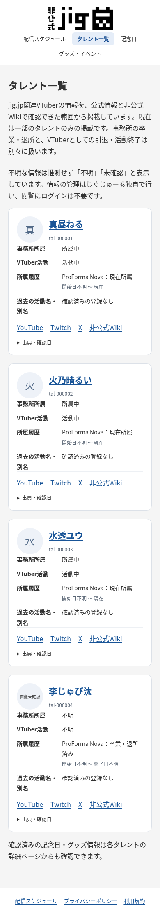 | 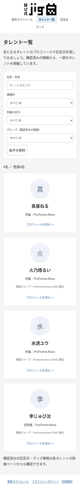 |

### タレント一覧 1440px

| Before | After |
| --- | --- |
| 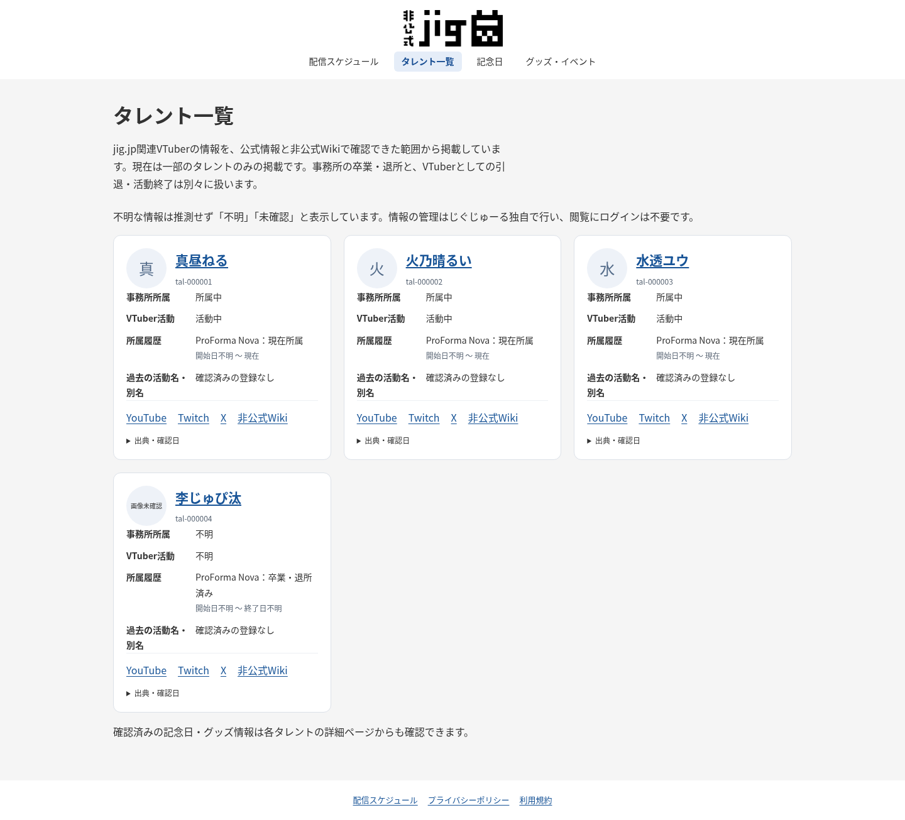 | 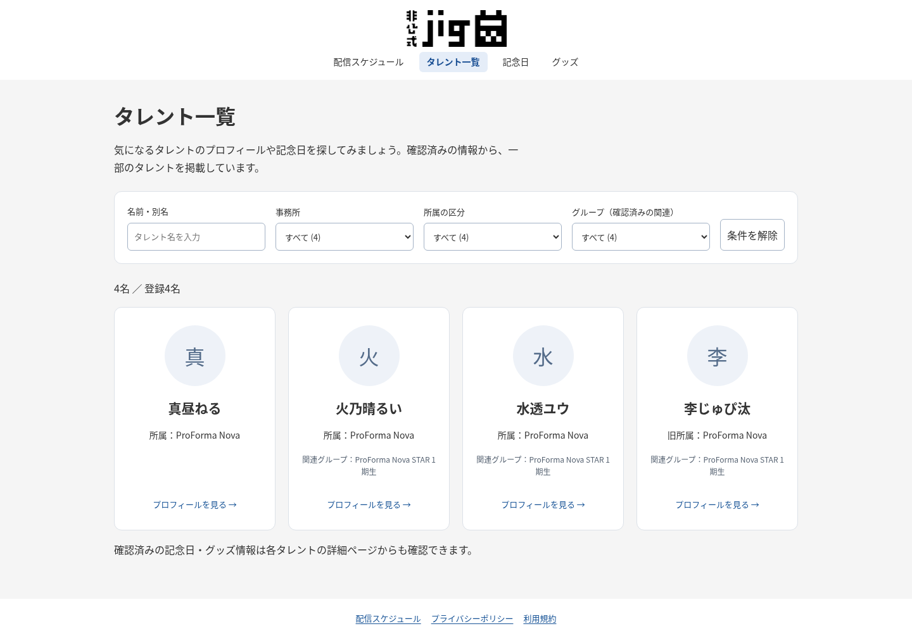 |

### 個別プロフィール 390px

| Before | After |
| --- | --- |
| 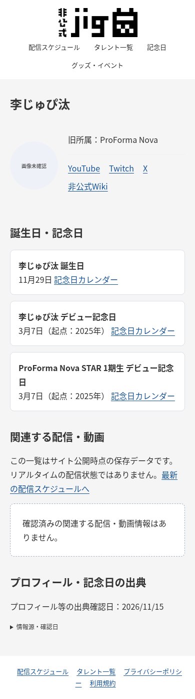 | 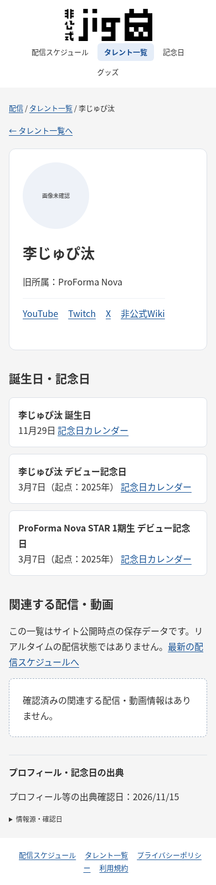 |

### 個別プロフィール 1440px

| Before | After |
| --- | --- |
| 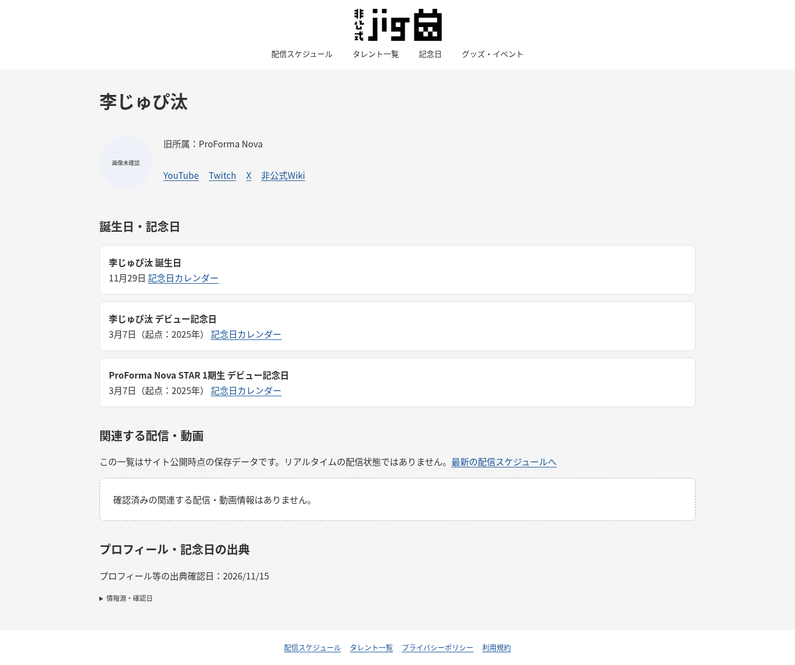 | 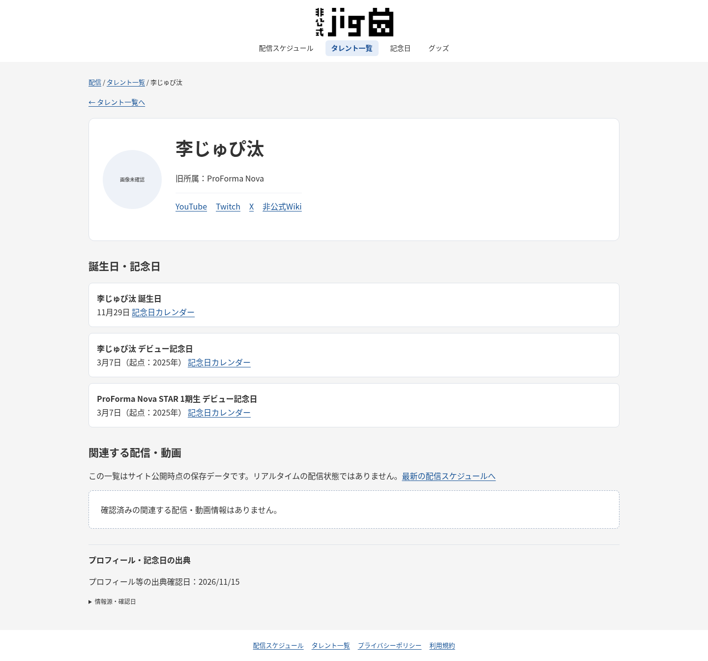 |

### 記念日 390px

| Before | After |
| --- | --- |
| 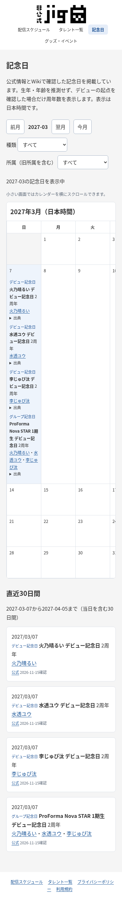 | 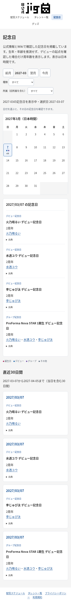 |

### 記念日 1440px

| Before | After |
| --- | --- |
| 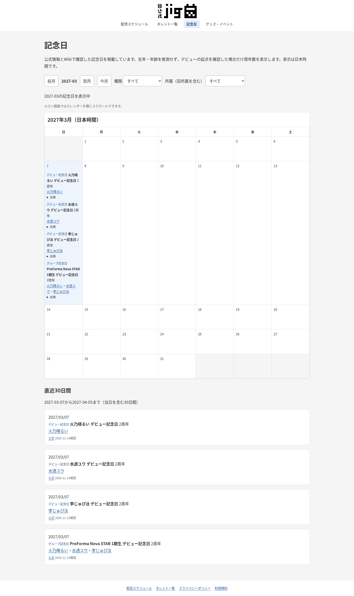 | 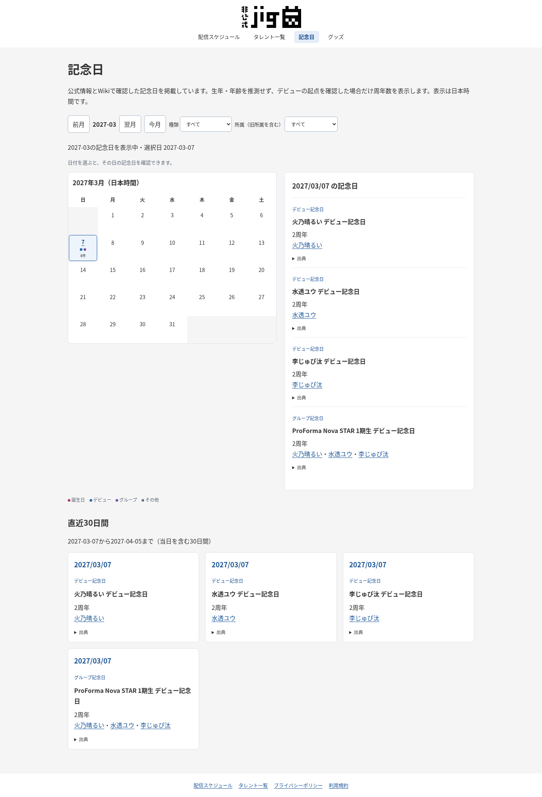 |

## 今回の対象外

タレント・記念日・グッズの新規登録、グループ在籍履歴の追加、イベントページ、本番への公開確認は対象外。グループの現在／旧所属まで絞り分けるには、根拠を伴うグループ在籍期間の台帳設計が次段階で必要です。大量登録時の実データ性能や実端末・支援技術による操作確認は継続課題です。
